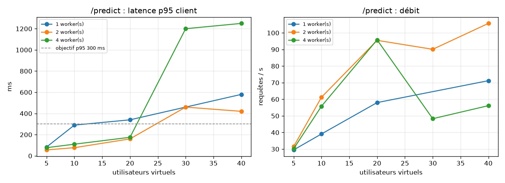
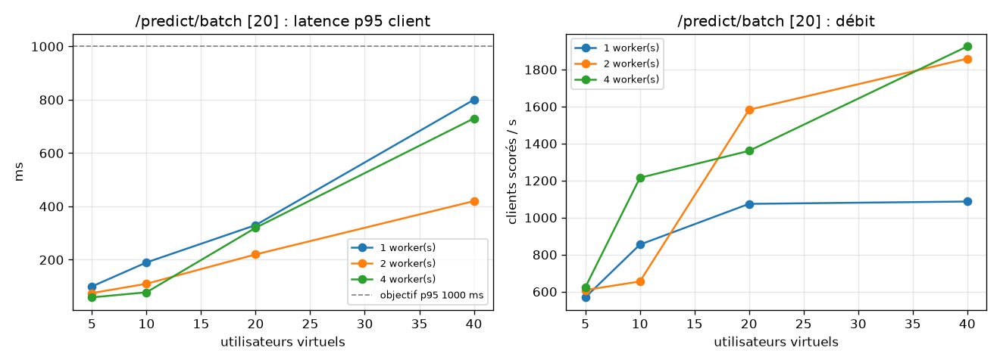

# Résultats des tests de charge

Protocole et objectifs : voir `protocole.md`.

## Capacité soutenable par configuration

| workers | scenario | palier_retenu_users | req_s | clients_s | p95_ms | repetitions | api_cpu_pct | api_rss_mb | statut |
|---|---|---|---|---|---|---|---|---|---|
| 1 | batch20 | 40 | 54.4 | 1087.1 | 800.0 | 1 | 103.7 | 237.2 | borne inférieure (aucun palier dégradé) |
| 1 | unit | 10 | 39.1 | 39.1 | 290.0 | 1 | 70.5 | 224.3 | saturation observée au palier suivant |
| 2 | batch20 | 40 | 93.0 | 1859.2 | 420.0 | 1 | 194.4 | 481.7 | borne inférieure (aucun palier dégradé) |
| 2 | unit | 20 | 95.5 | 95.5 | 160.0 | 4 | 150.35 | 471.79999999999995 | saturation observée au palier suivant |
| 4 | batch20 | 40 | 96.3 | 1925.2 | 730.0 | 1 | 275.3 | 916.3 | borne inférieure (aucun palier dégradé) |
| 4 | unit | 10 | 55.8 | 55.8 | 110.0 | 1 | 77.9 | 898.7 | saturation observée au palier suivant |

## Matrice complète (médiane des répétitions)

| workers | endpoint | users | rps | clients_per_s | p95_ms | fail_pct | slo_ok | repetitions | api_cpu_pct | api_rss_mb |
|---|---|---|---|---|---|---|---|---|---|---|
| 1 | /predict/batch [20] | 5 | 28.5 | 569.2 | 100.0 | 0.0 | True | 1 | 50.5 | 229.5 |
| 1 | /predict/batch [20] | 10 | 42.7 | 854.4 | 190.0 | 0.0 | True | 1 | 76.6 | 229.8 |
| 1 | /predict/batch [20] | 20 | 53.7 | 1074.4 | 330.0 | 0.0 | True | 1 | 98.3 | 230.9 |
| 1 | /predict/batch [20] | 40 | 54.4 | 1087.1 | 800.0 | 0.0 | True | 1 | 103.7 | 237.2 |
| 1 | /predict | 5 | 29.5 | 29.5 | 83.0 | 0.0 | True | 1 | 44.1 | 223.2 |
| 1 | /predict | 10 | 39.1 | 39.1 | 290.0 | 0.0 | True | 1 | 70.5 | 224.3 |
| 1 | /predict | 20 | 58.0 | 58.0 | 340.0 | 0.0 | False | 1 | 90.0 | 227.0 |
| 1 | /predict | 40 | 71.2 | 71.2 | 580.0 | 0.0 | False | 1 | 102.4 | 230.5 |
| 2 | /predict/batch [20] | 5 | 30.4 | 608.7 | 75.0 | 0.0 | True | 1 | 54.9 | 473.5 |
| 2 | /predict/batch [20] | 10 | 32.8 | 655.1 | 110.0 | 0.0 | True | 1 | 52.0 | 473.8 |
| 2 | /predict/batch [20] | 20 | 79.1 | 1582.9 | 220.0 | 0.0 | True | 1 | 155.8 | 475.5 |
| 2 | /predict/batch [20] | 40 | 93.0 | 1859.2 | 420.0 | 0.0 | True | 1 | 194.4 | 481.7 |
| 2 | /predict | 5 | 31.5 | 31.5 | 56.0 | 0.0 | True | 1 | 48.4 | 468.0 |
| 2 | /predict | 10 | 61.2 | 61.2 | 77.0 | 0.0 | True | 1 | 89.4 | 469.4 |
| 2 | /predict | 20 | 95.5 | 95.5 | 160.0 | 0.0 | True | 4 | 150.35 | 471.79999999999995 |
| 2 | /predict | 30 | 90.1 | 90.1 | 460.0 | 0.0 | False | 3 | 161.4 | 476.2 |
| 2 | /predict | 40 | 105.69999999999999 | 105.69999999999999 | 420.0 | 0.0 | False | 4 | 179.25 | 478.05 |
| 4 | /predict/batch [20] | 5 | 31.2 | 623.8 | 59.0 | 0.0 | True | 1 | 58.1 | 908.2 |
| 4 | /predict/batch [20] | 10 | 60.8 | 1215.3 | 78.0 | 0.0 | True | 1 | 113.7 | 908.7 |
| 4 | /predict/batch [20] | 20 | 68.0 | 1360.9 | 320.0 | 0.0 | True | 1 | 142.9 | 910.2 |
| 4 | /predict/batch [20] | 40 | 96.3 | 1925.2 | 730.0 | 0.0 | True | 1 | 275.3 | 916.3 |
| 4 | /predict | 5 | 30.2 | 30.2 | 77.0 | 0.0 | True | 1 | 43.6 | 896.7 |
| 4 | /predict | 10 | 55.8 | 55.8 | 110.0 | 0.0 | True | 1 | 77.9 | 898.7 |
| 4 | /predict | 20 | 95.80000000000001 | 95.80000000000001 | 175.0 | 0.0 | False | 4 | 141.14999999999998 | 905.15 |
| 4 | /predict | 30 | 48.3 | 48.3 | 1200.0 | 0.0 | False | 3 | 152.1 | 912.1 |
| 4 | /predict | 40 | 56.150000000000006 | 56.150000000000006 | 1250.0 | 0.0 | False | 4 | 188.1 | 914.75 |

## Scénario mixte (70 % unitaire, 20 % lot, 10 % feedback)

| workers | users | endpoint | requests | rps | p50_ms | p95_ms | p99_ms | fail_pct |
|---|---|---|---|---|---|---|---|---|
| 1 | 20 | /feedback | 387 | 6.5 | 170.0 | 270.0 | 290.0 | 0.0 |
| 1 | 20 | /predict | 2635 | 44.2 | 190.0 | 280.0 | 350.0 | 0.0 |
| 1 | 20 | /predict/batch [20] | 759 | 12.7 | 210.0 | 320.0 | 380.0 | 0.0 |
| 2 | 20 | /feedback | 566 | 9.5 | 45.0 | 170.0 | 250.0 | 0.0 |
| 2 | 20 | /predict | 3831 | 64.6 | 72.0 | 180.0 | 240.0 | 0.0 |
| 2 | 20 | /predict/batch [20] | 1142 | 19.2 | 89.0 | 220.0 | 310.0 | 0.0 |
| 4 | 20 | /feedback | 663 | 11.2 | 15.0 | 95.0 | 150.0 | 0.0 |
| 4 | 20 | /predict | 4732 | 79.8 | 35.0 | 120.0 | 180.0 | 0.0 |
| 4 | 20 | /predict/batch [20] | 1275 | 21.5 | 43.0 | 150.0 | 210.0 | 0.0 |

